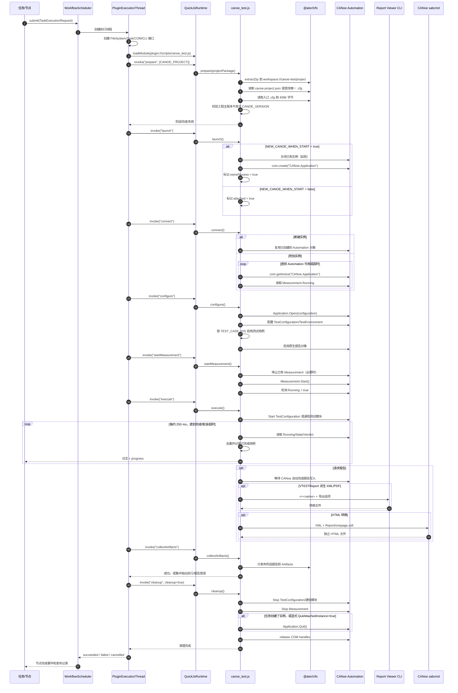
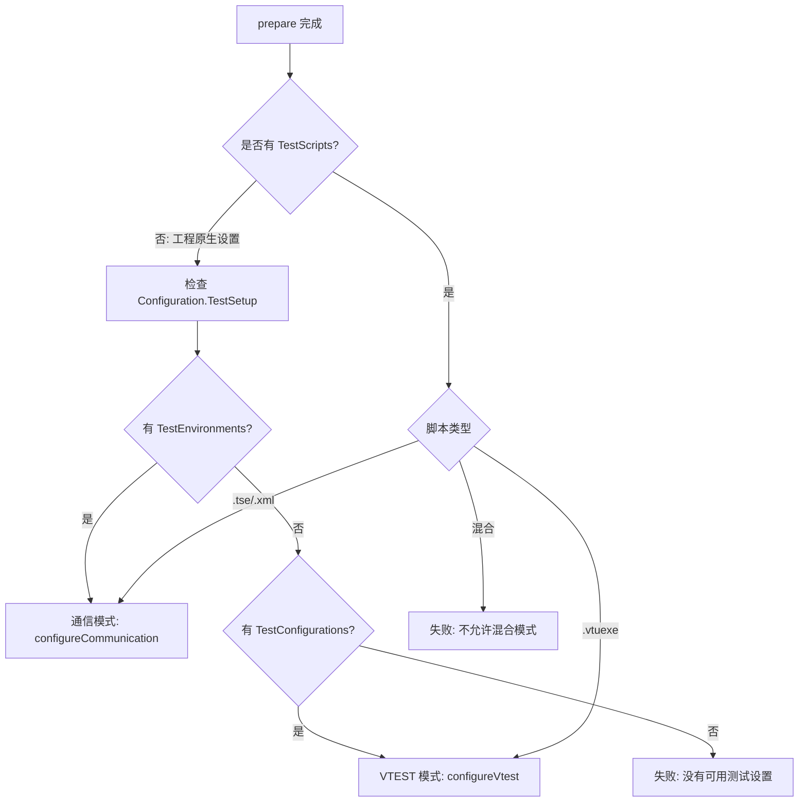
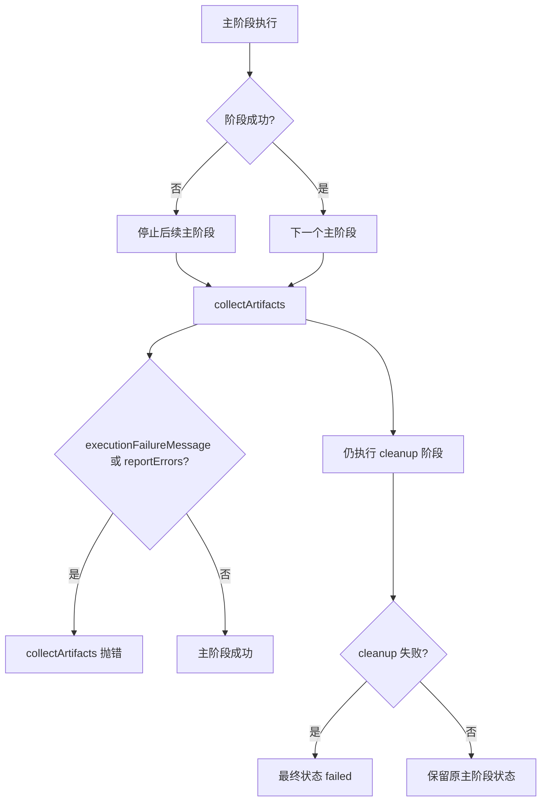
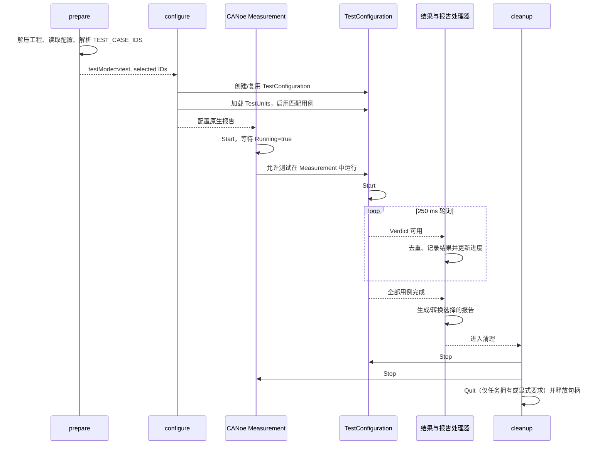

# canoe_test_adapter 执行逻辑

本文档基于仓库当前的 `canoe_test_adapter` **1.0.0** 源码和编译产物整理，描述从任务提交到 CANoe 测试结束、报告发布和资源清理的实际执行路径。

工程准备与用例筛选见[工程包说明](project-package.md)，插件入口见
[README](../README.md)。本目录共同维护当前 `ContractVersion: "1.0"` 契约。

## 1. 插件定位

插件是一个 JavaScript 工作流插件：宿主通过 QuickJS 加载 `scripts/canoe_test.js`，脚本通过 `@atech/fs`、`@atech/com`、`@atech/cli` 和 `@atech/task` 完成以下工作：

1. 解压并校验 CANoe 工程包。
2. 创建新的 CANoe Automation 实例，或附加到已有实例。
3. 打开配置，配置 VTEST 或通信测试单元。
4. 启动 Measurement 并顺序执行测试。
5. 轮询 Verdict，在内存中汇总测试结果并更新执行进度。
6. 生成/转换并发布用户选择的报告及描述文件声明的附加产物。
7. 停止测试、停止 Measurement，并按实例所有权释放 CANoe。

源码入口和职责如下：

| 层次 | 文件 | 主要职责 |
| --- | --- | --- |
| 工作流定义 | [`StepConfig.groovy`](../StepConfig.groovy) | 声明 6 个主阶段，`post.always` 依次收集报告与清理 |
| 插件清单 | [`PackageInfo.json`](../PackageInfo.json) | 声明运行时、COM/CLI 权限、输入和设备属性 |
| 阶段实现 | [`canoe_test.js`](../scripts/canoe_test.js) | 实现全部阶段、模式选择、结果和报告处理 |
| 报告自动化 | [`report_automation.js`](../scripts/canoe_test/report_automation.js) | 配置 TestConfiguration 联合报告并封装原生报告等待策略 |
| 报告文件 | [`report_files.js`](../scripts/canoe_test/report_files.js) | 解码 Report Viewer 输出并验证原生报告已经完成写入 |
| CANoe 会话 | [`session.js`](../scripts/canoe_test/session.js) | 显式进程启动、COM 激活/附加、配置打开、Measurement 启停、句柄释放 |
| 轮询工具 | [`poller.js`](../scripts/canoe_test/poller.js) | 250 ms 轮询、超时、取消检查、瞬时 COM 错误重试 |
| 工作流编译 | [`compile_plugin.py`](../../../../tools/compile_plugin.py) | 将 Groovy DSL 编译为 `workflow.json` 并组装插件包 |
| 宿主调度 | [`PluginExecution.cpp`](../../../service/task/PluginExecution.cpp) | 创建运行时接口、按顺序调用阶段、执行清理、汇总状态 |

## 2. 从 DSL 到运行时

`StepConfig.groovy` 不是运行时直接解释的脚本，而是构建期输入。编译器生成的核心工作流如下：

```text
StepConfig.groovy
    |
    | tools/compile_plugin.py
    v
workflow.json + PackageInfo.json + scripts/
    |
    | PluginManifestLoader / WorkflowScheduler
    v
PluginExecutionThread
    |
    | QuickJsRuntime.loadModule(plugin://scripts/canoe_test.js)
    v
scripts/canoe_test.js
    |
    +--> @atech/fs       工作区、压缩包、结果和产物
    +--> @atech/com      CANoe.Application Automation
    +--> @atech/cli      Report Viewer 转换
    +--> @atech/task     输入、日志、进度、发布、取消
```

编译后的 `workflow.json` 入口模块是 `scripts/canoe_test.js`，每个阶段只携带一个导出函数名；`prepare` 额外接收 `requirement:CANOE_PROJECT` 参数。

## 3. 阶段总表

阶段按声明顺序串行执行。主阶段任一失败后，宿主停止后续主阶段，但仍尝试执行全部 cleanup 阶段。

> 边界：只有通过请求校验、文件系统初始化、CLI 策略构建和脚本运行时初始化后，宿主才会
> 进入 `executeCleanupStages()`。这些前置步骤如果失败，会在进入脚本阶段前直接返回，
> 因此 `canoe_test.js` 的 `cleanup()` 不会被调用。若 QuickJS 已创建但入口模块加载失败，
> 宿主仍会尝试调用 cleanup 阶段；此时 cleanup 是否能执行取决于该模块是否实际加载成功。

| 顺序 | 阶段 ID | JS 导出 | 默认阶段超时 | 作用 |
| ---: | --- | --- | ---: | --- |
| 1 | `prepare` | `prepare(projectPackage)` | 60 s | 解压、读取工程描述、识别测试模式、解析输入 |
| 2 | `launch` | `launch()` | 60 s | 新建或选择已有 CANoe 实例 |
| 3 | `connect` | `connect()` | 150 s | 获取 Automation 和 Measurement 对象 |
| 4 | `configure` | `configure()` | 120 s | 打开配置并装载/筛选测试单元 |
| 5 | `start_measurement` | `startMeasurement()` | 120 s | 确认配置加载并启动 Measurement |
| 6 | `execute` | `execute()` | 24 h | 执行测试、轮询状态并记录用例结果 |
| 收尾 | `collect_artifacts` | `collectArtifacts()` | 600 s | 停止未完成测试，生成/发布所选报告、部分结果和 `Artifacts` 文件 |
| 清理 | `cleanup` | `cleanup()` | 60 s | 停止测试/Measurement，按所有权退出 CANoe，释放 COM |

阶段超时来自工作流定义。每个新完成的用例会重置宿主节点预算和脚本的
`TestTimeoutMs` 无进展预算；阶段总时限不重置，暂停等待不计入执行时长。

## 4. 总体时序



## 5. `prepare`：工程包和输入解析

两个 CANoe 适配器在插件 `prepare()` 中解压工程、确定实际入口 `.cfg` 后，
读取文件头中的 CANoe 软件主版本，并与任务设备属性 `CANOE_VERSION` 比较：
工程主版本小于或等于配置版本时通过，高于配置版本时使准备阶段失败。
例如配置 CANoe 18 可以加载 CANoe 16 工程，配置 CANoe 16 无法加载 CANoe 18 工程。
文件头中的 `;CANoe Version |格式号|主版本|次版本|...` 提供软件版本；
第二行存在 `Version:` 记录时还会核对两处主版本，格式号和插件包版本不参与比较。
文件头只读取前 4096 字节，支持 UTF-8、UTF-8 BOM、UTF-16 LE/BE。
入口不明确、版本无法识别或不兼容时，后续主阶段跳过，cleanup 仍执行；
版本不匹配时使用英文提示，仅展示工程版本和 `CANOE_VERSION`，不包含工程路径，
例如 `CANoe version mismatch. Project version is 18, but CANoe version is 15.`。
结构化错误信息仍保留配置文件路径、工程版本、配置版本及失败原因。
检查发生在启动或连接 CANoe 之前；刷写插件还会先于固件复制和系统变量修改检查。
GUI、TUI、平台任务与源码调试统一使用插件执行时的输入和设备属性快照，
前端仅做通用必填检查，任务装配负责输入复制，不再执行 CANoe 专用预检。
执行阶段仍核对 `Application.Version` 必须等于 `CANOE_VERSION`，
确保使用配置指定的 CANoe 实例加载工程。

### 5.1 解压与工程根目录

1. 固定解压目标为 `workspace://canoe-test/project`。
2. 优先查找根目录或子目录中的 `canoe-project.json`。
3. 找到描述文件时，以描述文件所在目录作为 `projectRootUri`。
4. 找不到描述文件时，递归查找 `.cfg`：必须恰好一个；该 `.cfg` 自动作为配置，并进入“使用工程原生测试设置”模式。

所有 `Configuration`、`TestScripts` 和 `Artifacts` 路径都必须是安全相对路径：不能包含反斜杠、盘符、绝对路径、空路径段、`.` 或 `..`。

### 5.2 `canoe-project.json` 常用字段

当前 v1 脚本实际读取的字段如下：

| 字段 | 是否必需 | 说明 |
| --- | --- | --- |
| `ContractVersion` | 是 | 必须为 `"1.0"` |
| `Configuration` | 是（描述文件模式） | 压缩包内 `.cfg` 的相对路径 |
| `TestScripts` 或 `Scripts` | 否 | `.vtuexe`、`.tse`、`.xml` 等脚本条目数组；省略或为空时回落到工程原生测试设置 |
| `TestConfiguration` | 否 | VTEST 模式下新建/复用配置的名称，默认 `CICT Test Configuration` |
| `TestCaseIds` | 否 | 当外部 `TEST_CASE_IDS` 为空时的默认用例 ID 数组 |
| `TestTimeoutMs` | 否 | `execute` 内部测试等待上限，默认 1800000 ms |
| `ConfigurationReadyTimeoutMs` | 否 | 等待配置加载，默认 120000 ms |
| `TestSetupReadyTimeoutMs` | 否 | 等待工程测试设置（描述文件未声明脚本或没有描述文件时），默认 120000 ms |
| `MeasurementStopTimeoutMs` | 否 | 打开配置前停止测量，默认 120000 ms |
| `AutomationReadyTimeoutMs` | 否 | Automation/Measurement 就绪等待，默认 120000 ms |
| `MeasurementStartTimeoutMs` | 否 | 启动 Measurement，默认 120000 ms |
| `ReportGenerationTimeoutMs` | 否 | 等待报告文件，默认 120000 ms |
| `ReportConversionTimeoutMs` | 否 | 单个报告的 Report Viewer 转换总时限（包含重试），默认 120000 ms |
| `Artifacts` | 否 | 需要额外发布的工程内相对路径数组；缺失项只告警 |

描述文件模式下，脚本类型不能混合：VTEST 脚本和通信脚本同时存在会在 `prepare` 失败。
未声明任何测试脚本时，适配器不报错，而是进入工程自动检测模式（见 7.3），
复用 `.cfg` 中已有的测试设置。

### 5.3 测试用例 ID

`TEST_CASE_IDS` 是可选输入，可指向 `.txt`/`.json` 文件，也可在调试调用中直接传入文本：

- 文本按换行、逗号或分号拆分。
- JSON 可以是字符串数组，也可以是 `ids`、`testCaseIds`、`TestCaseIds` 或 `cases` 数组。
- 为空时使用工程描述中的 `TestCaseIds`；仍为空则选择发现到的全部用例。
- 配置阶段会关闭未匹配的用例；没有任何匹配项时失败。

## 6. CANoe 实例与 Automation 连接

### 6.1 启动模式

设备属性 `NEW_CANOE_WHEN_START` 是主开关：

| 值 | `launch` 行为 | cleanup 默认行为 |
| --- | --- | --- |
| `true` | 尝试关闭已有 `CANoe.Application`，按 `CANOE_VERSION` 选择对应可执行文件并启动 `-embedding` 进程，再通过统一 ProgID 连接 Automation | 退出并回收任务创建的实例和进程 |
| `false` | 不创建新实例，`connect` 轮询 `com.getActive(...)` | 保留附加实例 |

兼容调试选项：当设备属性不可用时，脚本回退到 `AttachExisting` 选项；`QuitAttachedInstance=true` 可显式要求清理附加实例。

所有受支持 CANoe 版本的 COM ProgID 均为 `CANoe.Application`，不得添加版本号后缀。
新建模式以 `CANOE_VERSION` 为唯一选择源。宿主读取 Windows 的机器级和用户级、
32 位和 64 位卸载注册表，使用 `DisplayName=Vector CANoe <版本>` 与
`DisplayVersion` 主版本定位安装项，再从 `InstallLocation` 解析
`Exec64/CANoe64.exe`；附加模式连接当前活动实例。找不到对应安装项或可执行文件时，
会在启动进程前明确失败。
两种模式建立连接后都会读取 `Application.Version`，并与必需的 `CANOE_VERSION`
（当前为 `15`、`16`、`17`、`18`、`19` 或 `20`）比较主版本，不一致时以 `CANOE_VERSION_MISMATCH` 明确失败。

### 6.2 连接和 COM 故障

`CanoeSession` 持有 CANoe 进程句柄以及 `application`、`measurement`、`configuration`
三类 COM 句柄。适配器先尝试从 ROT 附加显式启动的实例；若该版本没有及时注册活动对象，
则等待进程稳定运行 5 秒后再通过统一的 `CANoe.Application` ProgID 激活。新建模式先读取
`Application.FullName` 和 `Path`，确认候选对象属于所选版本对应的可执行文件；其他安装
注册的活动对象会被拒绝并继续等待。路径匹配后再读取 `Application.Version` 并核对
`CANOE_VERSION`，因此路径自身配置错误会立即以 `CANOE_VERSION_MISMATCH` 失败。

进程在启动或后续操作期间退出都会立即报告 PID、退出码、可执行文件和进程输出。连接建立
前，`0x80080005`、RPC 服务暂不可用、RPC 忙、调用被拒绝和对象尚未就绪等启动期错误可在
总超时内重试。连接建立后，`0x800706ba`、`0x800706be`、`0x80010108` 等 Automation
断连错误会保留 HRESULT 并立即失败，不会再被可选属性读取吞掉或退化为轮询超时。

打开配置的核心步骤：

1. 如已有 Measurement 在运行，先 `Stop` 并等待 `Running=false`。
2. 调用 `Application.Open(nativeConfigurationPath, true, false)`。
3. 轮询 `Application.Configuration` 和 `OpenConfigurationResult`。
4. 无描述文件模式额外等待 `TestEnvironment` 或 `TestConfiguration` 出现。

## 7. `configure`：三种测试模式



### 7.1 VTEST 模式

`configureVtest()`：

1. 获取或创建第一个 `TestConfiguration`。
2. 声明了测试脚本时设置名称（默认 `CICT Test Configuration`）、启用配置并尽量设置单次执行模式。
3. 清空已有 `TestUnits`，加入每个 `.vtuexe` 脚本；工程原生设置模式（未声明脚本）则复用已有单元。
4. 递归遍历 `Elements`/`Sequence`，识别测试用例并按 ID 设置用例和单元的 `Enabled`。
5. 保存 `selectedTestCases` 和 `expectedResultCount`，收集 `TestConfiguration.Report`。

### 7.2 通信测试模式

`configureCommunication()`：

1. 获取 `Configuration.TestSetup.TestEnvironments`。
2. 如果提供 `.tse`，先移除已有环境并加入脚本。
3. 递归收集 `TestModules` 或嵌套 `Items` 中的通信测试模块，并按名称去重。
4. 如果提供 `.xml`，只启用名称匹配的模块。
5. 按 `TEST_CASE_IDS` 启用模块内用例，保存 `activeCommunicationModules` 和预期结果数。
6. 保留 CANoe 工程自身的通信测试报告配置，不读取或改写环境/模块级报告对象。

### 7.3 工程自动检测模式

当工程没有声明任何测试脚本时（没有 `canoe-project.json`、或描述文件省略了
`TestScripts`，且压缩包恰好只有一个 `.cfg` 时才允许没有描述文件），`prepare` 会置为
工程原生设置模式，`openConfiguration()` 等待工程测试设置就绪后，
`configureProjectTests()` 检查已打开配置：

- 有 `TestEnvironments`：切换为通信模式并复用工程环境。
- 否则有 `TestConfigurations`：切换为 VTEST 模式并复用工程配置。
- 两者都没有：失败。

## 8. `startMeasurement` 与 `execute`

### 8.1 启动 Measurement

`startMeasurement()` 再次调用统一的 `openConfiguration()`（配置已打开时不会重复打开），然后：

- 读取 `Measurement.Running`；
- 未运行则调用 `Start`；
- 轮询到 `Running=true`；
- 将会话状态 `measurementRunning` 置为 `true`。

### 8.2 执行顺序

| 模式 | 启动调用 | 顺序 |
| --- | --- | --- |
| VTEST / 工程 TestConfiguration | `TestConfiguration.Start()` | 一次启动，等待整体完成 |
| 通信测试 | 每个 `activeCommunicationModules` 调用 `module.Start()` | 模块按数组顺序串行执行 |

轮询条件同时观察运行状态和已完成 Verdict 数：

- VTEST：`TestConfiguration` 仍在运行，或已记录结果数小于 `expectedResultCount`。
- 通信：当前模块仍在运行，或该模块已完成结果数不足。

每轮约 250 ms：

1. 读取 `Running`/`Executing`/`IsRunning`/`State`。
2. 读取嵌套测试元素的 `Verdict`。
3. 忽略“不可用” Verdict，按 `testUnit + id` 去重。
4. 将刚完成的用例保存在内存中、写入任务日志，并更新进度（约 20% 到 90%）。

测试用例结果判定为 `passed` 的值包括 `Passed`、`Pass`、`cVerdictPassed` 和 `0`；其他可用 Verdict 都会进入结果集合并导致任务失败。结果集合只用于本次执行的进度和最终状态判定，不会生成独立 JSON 文件。

## 9. 报告和产物

### 9.1 发布 URI

| 内容 | URI | 发布 ID |
| --- | --- | --- |
| 原生 VTESTReport | `artifact://canoe-test/reports/<filename>.vtestreport` | `CANOE_REPORT:vtestreport` |
| 原生 XML | `artifact://canoe-test/<relative .xml>` | `CANOE_REPORT:XML` |
| PDF 转换 | `artifact://canoe-test/reports/canoe-test[(-N)].pdf` | `CANOE_REPORT:PDF` |
| XML 转换 | `artifact://canoe-test/reports/canoe-test[(-N)].xml` | `CANOE_REPORT:XML` |
| HTML 转换 | `artifact://canoe-test/reports/canoe-test[(-N)].html` | `CANOE_REPORT:HTML` |
| 描述文件中的额外文件 | `artifact://canoe-test/<relative>` | `ARTIFACT:<relative>` |

适配器不会创建 `results/` 或 `test-results.json`。产物目录只包含用户通过
`CANOE_REPORT_TYPE` 选择的 CANoe 报告，以及 `canoe-project.json` 的 `Artifacts`
显式声明的附加文件。

表中的 `<relative>` 是工程根目录下的相对路径；`task.publish()` 实际发布的是对应的
`artifact://canoe-test/...` URI。原生 VTESTReport 统一按原文件名复制到 `reports/`；
多个源报告同名时，从第二个开始在扩展名前追加 `-2`、`-3` 等后缀，避免覆盖。相同报告
类型有多个文件时，首个发布 ID 使用 `CANOE_REPORT:<type>`，后续文件依次追加 `:2`、
`:3` 等后缀。

### 9.2 报告生成策略

1. `configure` 阶段保存已有报告文件快照。VTEST 模式通过
   `TestConfiguration.Report.UseJointReport` 启用联合报告并设置格式；通信模式沿用工程配置。
2. `execute` 结束后，所有模式都等待 CANoe 自动完成报告写入，不调用不存在于
   `TestConfiguration.Report` 的主动生成方法。
3. VTEST 模式只接收 `TestConfiguration.Report.LastWrittenFullPath` 确认的最终路径；
   通信测试没有该报告对象时才扫描工程目录。目录扫描会忽略 CANoe 的
   `rpt<十六进制>.vtestreport` 暂存文件，所有模式都会拒绝配置阶段基线中的未变化
   文件，并等待非空报告连续三个 250 ms 轮询快照保持一致。
4. 只有稳定报告才会用于 Report Viewer 转换和发布。Report Viewer 始终直接读取 CANoe
   原始目录中的报告，确保图片等相对路径资源可以正常解析；发布原生 VTESTReport 时，
   再将文件复制到产物根目录的 `canoe-test/reports/`。
5. 只选择 `XML`/`HTML` 时，VTEST 模式设置原生格式为 XML；任一选择包含
   `vtestreport` 或 `PDF` 时设置为 VTESTReport，保证所有选中格式都有可转换的共同源。
6. `XML` 若没有原生 XML，则使用 Report Viewer 的 `-e` 转换；`PDF` 使用 `-p`。
   HTML 与 XML 共用同一份原生或导出的 XML，不重复调用 Report Viewer。
7. HTML 使用 CANoe 安装目录中的 `sabcmd.exe` 和官方 `Report/onepage.xslt` 生成单页报告；
   CSS 与展开脚本由官方样式表写入 HTML。宿主根据 `CANOE_VERSION` 从同一安装项的
   `InstallLocation` 自动解析 `Exec64/sabcmd.exe`，并以命名 CLI 权限提供给脚本。
8. 从 VTESTReport 导出 XML/PDF 时，宿主根据 `CANOE_VERSION` 自动发现同主版本的
   `Vector CANoe Test Report Viewer <version> [SPx]`，并将解析出的
   `ReportViewerCli.exe` 路径作为命名 CLI 权限提供给脚本。日志会记录所选 CANoe
   主版本和最终路径，不再要求用户配置可执行文件。
9. Report Viewer 返回退出码 `104` 或输出包含 `IncompatibleReportException` 时，视为
   CANoe 尚未完成报告收尾。脚本每隔 1 秒重试，并把 `ReportConversionTimeoutMs`
   作为单个报告转换的总时限；进程崩溃和其他错误立即失败。每次尝试前都会删除上次
   失败留下的目标文件。
10. Report Viewer 和 sabcmd 的 stdout/stderr 同时保留原始字节和宿主按 Windows 本地
    代码页解码的文本。转换错误优先使用本地文本，并同时报告实际输入路径。

报告生成/转换错误通常先记录为 warning 和 `reportErrors`，不会立即中断 `execute`；`collectArtifacts` 会把这些错误与测试失败合并后统一抛出。

## 10. 失败、取消、暂停和清理

### 10.1 失败传播



测试 Verdict 失败的特殊点：

1. `execute` 收集已完成的测试用例；报告统一由必执行收尾生成和发布。
2. `execute` 设置 `executionFailureMessage = "One or more CANoe test cases failed"` 并调用 `task.error()`，但脚本继续进入报告处理。
3. `collectArtifacts` 发布产物后，将该消息和报告错误合并成最终异常。

宿主侧的状态优先级如下：

| 条件 | `PluginExecutionThread` 结果 |
| --- | --- |
| 主阶段产生取消错误 | `cancelled`，清理错误保存在 `cleanupError` |
| 主阶段产生其他错误 | `failed`，保留主阶段错误 |
| 主阶段成功、仅 cleanup 失败 | `failed`，错误来自 `cleanupError` |
| 主阶段和 cleanup 都成功 | `succeeded` |

如果取消令牌在清理结束后才被观察到，宿主会补记取消错误；调度器在完成节点时也会优先
响应已请求的取消，因此取消可能覆盖原本的节点失败状态。

### 10.2 取消

- 宿主设置取消令牌，并请求当前运行时中断。
- `Poller.until()` 每轮调用 `task.checkCancelled()`；`task.delay()` 也会响应取消。
- 运行时初始化后，取消不会跳过报告收集和 cleanup；两者均忽略取消并使用独立预算。
- 最终状态优先为 `cancelled`，即便 cleanup 同时产生 warning 或错误。
- 若取消发生在文件系统、CLI 策略或运行时初始化阶段，脚本级 `cleanup()` 尚未具备调用条件，
  只能由宿主完成线程和运行时的收尾。

### 10.3 暂停和超时

- 宿主在进入阶段前等待恢复；暂停等待时间从节点和阶段耗时中扣除。
- 状态轮询调用 `task.checkpoint()`；暂停时对活动 TestConfiguration/TestModule 调用
  `Pause()`，继续时调用 `Resume()`，完成调用后才回执对应任务状态。
- 这与 [py-canoe TestConfiguration](https://github.com/auto-py-utils/py-canoe/blob/main/src/py_canoe/core/child_elements/test_configuration.py)
  和 [TestModule](https://github.com/auto-py-utils/py-canoe/blob/main/src/py_canoe/core/child_elements/test_module.py)
  的 Automation 调用一致；不使用仅适用于离线测量的 `Measurement.Break()`。
- 主阶段同时受阶段总时限与可按用例续期的节点预算约束。
- 报告收尾独立预算为 600 s，资源清理为 60 s，不受节点剩余时间限制。
- `Poller` 超时产生 `WAIT_TIMEOUT`，并保留最后一次可读错误文本。

### 10.4 cleanup 具体动作

`cleanup()` 按以下顺序执行，并将单项停止异常记录为 warning：

1. 若测试已启动，停止 `TestConfiguration`。
2. 停止所有活动通信测试模块。
3. 尝试停止 Measurement。
4. 当 `canoe.ownsProcess=true`，或 `QuitAttachedInstance=true`，调用 `Application.Quit()`。
5. 释放 configuration、measurement、application COM 句柄并重置脚本状态。

## 11. 宿主侧状态机要点

`PluginExecutionThread::run()` 的关键顺序是：

```text
校验请求/初始化文件系统
  -> 构造 TaskInterface、CliInterface、ComInterface
  -> 创建 QuickJsRuntime
  -> loadPluginModule()
  -> executePrimaryStages()
       prepare -> launch -> connect -> configure
       -> startMeasurement -> execute -> collectArtifacts
  -> executeCleanupStages()
       cleanup
  -> 汇总 publications、error、cleanupError
  -> 销毁脚本 VM 和 DLL 句柄
  -> 发布 executionFinished
```

宿主记录每个阶段的 `stageStarted`、`stageFinished`、进度和发布事件；脚本的 `task.info/warning/error/publish` 都通过 `TaskInterface` 回传给任务系统。

## 12. 输入、权限和运行前提

### 12.1 插件输入

| 类型 | ID | 约束 |
| --- | --- | --- |
| 必需文件 | `CANOE_PROJECT` | `.zip`，包含 `canoe-project.json` 或唯一 `.cfg` |
| 可选文本文件 | `TEST_CASE_IDS` | `.json` 或 `.txt`，用于筛选用例 |
| 必需多选枚举 | `CANOE_REPORT_TYPE` | `vtestreport`、`XML`、`HTML`、`PDF` 至少选一个 |

`CANOE_REPORT_TYPE` 按 `PackageInfo.json` 中的 ID 精确匹配，包括大小写；脚本不接受
清单之外的别名。

### 12.2 设备属性

| ID | 用途 | 当前脚本行为 |
| --- | --- | --- |
| `CANOE_VERSION` | 目标 CANoe 主版本 | 必需单选枚举，内置 `15`、`16`、`17`、`18`、`19`、`20`；宿主据此从 Windows 安装信息自动定位 `Exec64/CANoe64.exe`，连接后与 `Application.Version` 核对，不参与 ProgID 构造 |
| `CANOE_PROJECT_DIR` | 任务工作区根目录声明 | v1 脚本未直接读取；实际工程根固定在 `workspace://canoe-test/project` |
| `CANOE_INSTALL_DIR` | 手工指定 CANoe 安装根目录 | 可选；**仅在按 `CANOE_VERSION` 自动发现失败时**作为 `Exec64/CANoe64.exe`、`Exec64/sabcmd.exe` 的基目录使用 |
| `CANOE_REPORT_VIEWER_DIR` | 手工指定 Report Viewer 安装目录 | 可选；同上，用于失败时定位 `ReportViewerCli.exe` |
| `NEW_CANOE_WHEN_START` | 新建或附加 CANoe | 必需布尔值 |

手工目录用于并存安装、复制安装等不写入 `Uninstall` 注册项的部署方式：注册表能发现
时始终优先使用注册表结果，只有发现失败且目录属性已配置才回退到手工目录；配置的目录
里缺少相对路径对应的文件时，以 `notFound` 失败并在详情中给出期望的完整路径。

### 12.3 权限

- COM：仅允许无版本后缀的 `CANoe.Application`，允许活动对象附加。
- CLI：CANoe、`sabcmd` 与 Report Viewer 路径均由宿主按 `CANOE_VERSION` 自动发现，
  失败时按上文的手工目录属性兜底；只允许这些清单声明的命名可执行文件，不允许任意终端。
- JavaScript 运行时 API 由 `@atech/task` 暴露：`requirement`、`device`、`option`、日志、进度、发布、取消和延时。

## 13. 典型时序示例



## 14. 维护时的核对清单

修改插件时建议同时核对：

- `StepConfig.groovy`、生成的 `workflow.json`、`PackageInfo.json` 的阶段和权限是否一致。
- 新增阶段是否考虑主阶段失败后的 cleanup 路径。
- 所有 CANoe COM 读取是否通过 `Poller` 处理瞬时不可用和取消。
- 新增报告格式是否同时更新输入枚举、原生发现、转换参数、媒体类型和发布 ID。
- 结果记录是否保持 `testUnit + id` 去重，避免轮询重复计数。
- 工程内路径是否经过安全相对路径校验。
- 如调整工程契约，同步更新[工程包说明](project-package.md)与相关运行时契约测试。

## 15. 关键源码定位

- 工作流声明：[`StepConfig.groovy`](../StepConfig.groovy)
- 插件清单：[`PackageInfo.json`](../PackageInfo.json)
- 工程解析和阶段导出：[`canoe_test.js`](../scripts/canoe_test.js)
- VTEST 配置：[`canoe_test.js`](../scripts/canoe_test.js)
- 通信测试配置：[`canoe_test.js`](../scripts/canoe_test.js)
- 结果记录与最终判定：[`canoe_test.js`](../scripts/canoe_test.js)
- 报告生成与转换：[`canoe_test.js`](../scripts/canoe_test.js)
- 报告 COM 边界：[`report_automation.js`](../scripts/canoe_test/report_automation.js)
- 清理：[`canoe_test.js`](../scripts/canoe_test.js)
- CANoe 会话：[`session.js`](../scripts/canoe_test/session.js)
- 轮询和取消：[`poller.js`](../scripts/canoe_test/poller.js)
- 宿主阶段执行：[`PluginExecution.cpp`](../../../service/task/PluginExecution.cpp)
- 宿主主阶段/清理阶段：[`PluginExecution.cpp`](../../../service/task/PluginExecution.cpp)
- QuickJS Task API：[`TaskModule.cpp`](../../../runtime/language/js/modules/TaskModule.cpp)
- 当前 v1 契约测试：[`runtime_interface_test.cpp`](../../../../test/runtime_interface_test.cpp)
- CANoe 自动化策略测试：[`runtime_interface_test.cpp`](../../../../test/runtime_interface_test.cpp)
